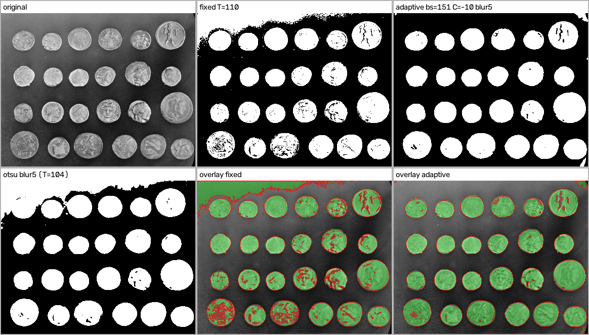
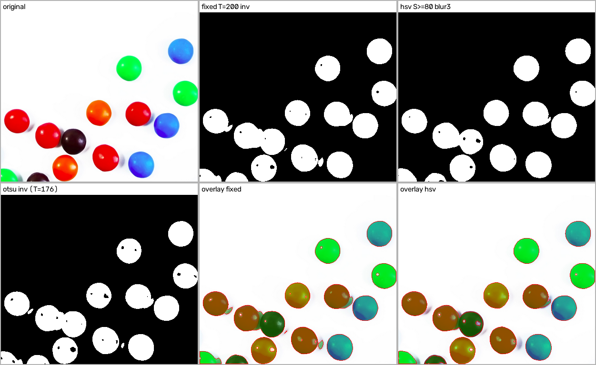
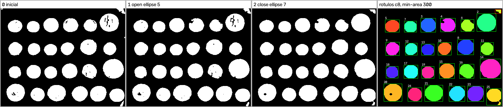
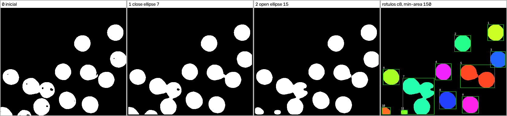
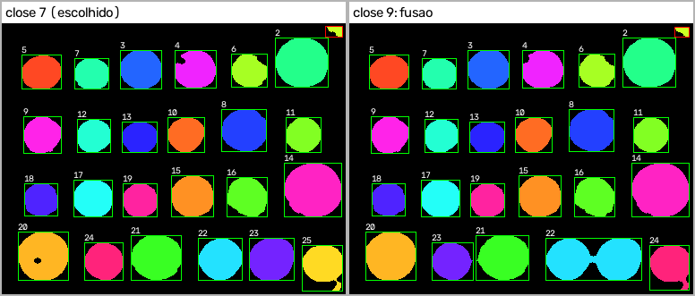
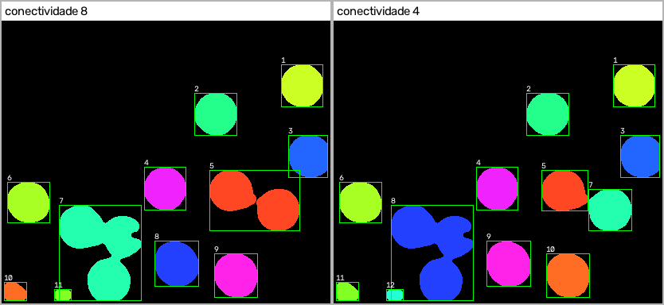

# REPORT — Laboratórios M2.1 e M2.2

Processamento de Imagens 2026-02 · Mateus Rachadel Lohn · Python + OpenCV

Todos os números abaixo saem das execuções em `scripts/run_study.py` (impressões do `segment` e arquivos `results/*_summary.json`). As figuras são geradas por `scripts/make_figures.py` em `results/figures/`.

---

# M2.1 — Máscara binária e segmentação

## 1. Alvo e imagens

**Objeto de interesse:** objetos compactos e arredondados destacados do fundo, contados um por unidade física (uma moeda, um confeito). Sombra, reflexo e fundo não contam como objeto. Objeto cortado pela borda da imagem conta como objeto.

| Imagem | Conteúdo | Papel no estudo | Origem e licença |
|---|---|---|---|
| `images/input/coins.png` (384×303, cinza) | 24 moedas gregas sobre fundo escuro | **caso difícil**: iluminação irregular (fundo ~126 no canto superior esquerdo e ~74 no inferior) e relevo das moedas com regiões escuras | conjunto de dados do scikit-image (`skimage.data.coins`), foto do acervo do Brooklyn Museum publicada no Flickr Commons sem restrições de copyright conhecidas |
| `images/input/smarties.png` (413×356, BGR) | 14 confeitos coloridos sobre fundo branco (12 inteiros + 2 cortados na borda inferior) | **caso favorável** em contraste, com vários objetos, contato entre confeitos, sombras e reflexos | `samples/data` do repositório do OpenCV (licença Apache 2.0) |

As contagens de referência (24 e 14) foram feitas **por inspeção visual da imagem original**; não existe máscara de referência. Os arquivos originais estão em `images/input/` sem alteração.

## 2. Configurações e parâmetros

Convenção: 255 = objeto. No limiar em cinza, sem `--invert` o objeto é o que fica **acima** do limiar (pixel > T); com `--invert` é o que fica **abaixo ou igual** (pixel ≤ T).

| Imagem | Config. | Método | Pré-processamento | Parâmetros | Inversão |
|---|---|---|---|---|---|
| coins | 1 | `fixed` | nenhum | T = 110 | não (moeda é clara) |
| coins | 2 ✔ | `adaptive` (gaussiano) | Gaussiano 5×5 | bloco = 151, C = −10 | não |
| coins | ref. | `otsu` | Gaussiano 5×5 | T calculado = 104 | não |
| smarties | 1 | `fixed` | nenhum | T = 200 | **sim**: confeitos são mais escuros que o fundo branco em cinza |
| smarties | 2 ✔ | `hsv` | Gaussiano 3×3 | H 0–179, S 80–255, V 0–255 | não |
| smarties | ref. | `otsu` | nenhum | T calculado = 176 | sim |

**Justificativa do pré-processamento.** Nas moedas, o desfoque 5×5 reduz o efeito da textura do relevo sobre a média local do adaptativo. Nos confeitos, o desfoque 3×3 suaviza ruído de compressão nas bordas antes da conversão para HSV. O limiar fixo foi rodado **sem** pré-processamento nas duas imagens, então a comparação fixa × segunda configuração mistura método e pré-processamento. Isso está indicado na tabela.

**Escolha do HSV.** Como o alvo são confeitos de todas as cores, o intervalo usa matiz completo (0–179) e separa pelo canal S: o fundo branco tem S ≈ 0 e a sombra cinza-azulada S ≈ 21, enquanto os confeitos ficam acima de 200 (inclusive o marrom, com V baixo, por isso V começa em 0). Não houve faixa cruzando a descontinuidade do matiz nesse caso. Mesmo assim a implementação trata isso: se Hmin > Hmax, a faixa é dividida em [Hmin, 179] ∪ [0, Hmax]. A demonstração com só os vermelhos (`--hsv-lower 170,120,60 --hsv-upper 8,255,255`) está em `results/figures/m21_smarties_red_wrap.png` e é testada em `test_hsv_hue_wraparound`.

## 3. Proporção de primeiro plano

Saídas do `segment` (todas validadas: 1 canal, mesmas dimensões da entrada, valores {0, 255}).

| Imagem | Configuração | Pixels de objeto | Proporção |
|---|---|---|---|
| coins | fixed T=110 | 43 569 | 0,374 |
| coins | otsu blur5 (T=104) | 48 069 | 0,413 |
| coins | **adaptive** bs=151 C=−10 blur5 | 39 208 | **0,337** |
| smarties | fixed T=200 inv | 29 924 | 0,204 |
| smarties | otsu inv (T=176) | 28 929 | 0,197 |
| smarties | **hsv** S≥80 blur3 | 29 313 | **0,199** |

## 4. Figuras

*Figura 1 — Moedas. Linha de cima: original, limiar fixo T=110 e adaptativo. Linha de baixo: Otsu e as sobreposições (verde = objeto, vermelho = contorno da máscara) do fixo e do adaptativo.*

*Figura 2 — Confeitos. Linha de cima: original, limiar fixo invertido T=200 e HSV. Linha de baixo: Otsu invertido e as sobreposições do fixo e do HSV.*

## 5. Discussão e escolha da configuração de trabalho

**Moedas — escolhida a adaptativa.** Observação visual nas sobreposições:

- *Falso positivo do fixo/Otsu:* a faixa de fundo mais clara no topo e no canto superior esquerdo passa do limiar e vira uma grande região de objeto colada às moedas da primeira linha. O Otsu (T=104) piora isso, porque escolhe um limiar ainda mais baixo. O teste `test_fixed_threshold_limitation_on_coins` confirma: no canto superior esquerdo (25×60 px de fundo), o fixo marca mais de 50% como objeto e o adaptativo menos de 10%.
- *Falso negativo do fixo:* nas moedas da última linha (região mais escura), o relevo escuro cai abaixo de 110 e a moeda vira um "rendado" de pedaços. Na máscara inicial do fixo há 87 componentes (c8) para 24 moedas.
- *Adaptativa:* compara cada pixel com a média local (bloco 151), então acompanha a variação de iluminação. As moedas saem inteiras na maioria, com alguns furos pequenos no relevo (falso negativo interno). Restam dois falsos positivos pequenos, nos cantos superior direito e inferior direito, onde o bloco se estende além da imagem.

**Confeitos — escolhido o HSV.** As três máscaras são parecidas em proporção (0,197–0,204), mas diferem no tipo de erro:

- *Fixo invertido T=200:* inclui parte das **sombras** à direita/abaixo dos confeitos (cinza ≈ 205, perto do limiar), que aparecem como "caudas", e perde os **reflexos especulares** (pontos brancos) como furos.
- *HSV:* a sombra tem saturação baixa e quase toda fica de fora. Os reflexos continuam como furos pequenos, porque o branco do reflexo tem S ≈ 0.
- *Erro comum aos três:* confeitos encostados (vermelho + marrom à esquerda; vermelho + azul no centro-direita) saem como uma região só.

### Respostas

**(a) Quando o limiar fixo funcionou ou falhou.** Nos confeitos funcionou razoavelmente, porque o fundo é branco e uniforme e existe uma faixa larga de limiares que separa objeto e fundo (de T=180 a T=220 a proporção varia só entre 0,198 e 0,209). O erro principal foi incluir sombra. Nas moedas falhou: com iluminação irregular, nenhum T único separa as moedas escuras de baixo sem incluir o fundo claro de cima.

**(b) Parâmetro mais sensível.** O limiar fixo nas moedas. Variando T de 100 a 130 (sem pré-processamento), a proporção cai de 0,420 para 0,282 e a máscara inicial passa de 100 para 147 componentes (c8): limiar baixo engole fundo, limiar alto fragmenta as moedas. No adaptativo, o parâmetro mais sensível foi o tamanho do bloco: com bloco 51 (C=−5) a máscara teve 90 componentes, porque o bloco é menor que as moedas e "esvazia" o centro delas; com 151 caiu para 28.

**(c) Erros que atrapalham a contagem na M2.2.**
1. Objetos encostados ou ligados por sombra formam um componente só, o que dá **subcontagem**.
2. Fragmentação (relevo das moedas no limiar fixo) gera **sobrecontagem**.
3. Falsos positivos pequenos (cantos, respingos) geram componentes extras, que podem ser tratados com filtro de área.
4. Furos internos não mudam a contagem, mas reduzem a área medida.

**Observação vs. métrica.** Sem máscara de referência, a análise acima é visual. As únicas medidas quantitativas são proporção de primeiro plano e número de componentes. Não são declaradas acurácia, precisão ou revocação.

---

# M2.2 — Componentes conexos e sequência morfológica

## 1. Ponto de partida

As máscaras de trabalho são as configurações escolhidas na M2.1: `images/output/coins_adaptive_mask.png` e `images/output/smarties_hsv_mask.png`. Nelas o objeto é branco (255) e o fundo preto (0); o `analyze` valida isso antes de rodar. A cópia da máscara inicial é salva como `results/<caso>_stage0_initial.png`.

## 2. Conectividade 4 × 8 na máscara inicial

Mesma máscara, mesmos parâmetros, fundo excluído:

| Máscara inicial | c4 | c8 |
|---|---|---|
| coins (adaptativa) | 29 | 28 |
| smarties (HSV) | 13 | 13 |
| coins (fixo, só para comparação) | 159 | 87 |

Na **conectividade 4**, dois pixels só se conectam se dividem uma aresta. Na **8**, basta dividirem um canto (vizinho diagonal). Por isso c8 ≤ c4 sempre. A diferença aparece em máscaras com contornos serrilhados ou pedaços que se tocam só pela diagonal: na máscara fixa das moedas, o relevo fragmentado tem muitos pedaços diagonais, e a contagem cai de 159 (c4) para 87 (c8). Na adaptativa a diferença é de um componente só. A análise final usa **c8**, porque um objeto físico contínuo não deveria se quebrar em dois por causa de um degrau diagonal de um pixel.

## 3. Sequência morfológica

Configurações em `config/coins_morph.json` e `config/smarties_morph.json`. Todos os elementos estruturantes são elípticos (os objetos são redondos, e a elipse altera menos o contorno do que o retângulo), com 1 iteração e borda constante 0.

### Moedas: abertura 5×5, depois fechamento 7×7

| Ordem | Operação | Elemento | Problema visado | Pixels de objeto após |
|---|---|---|---|---|
| 0 | — | — | máscara inicial | 39 208 |
| 1 | abertura | elipse 5×5, 1 it. | remover respingos e pontas finas que o adaptativo cria no fundo e nos cantos | 38 961 |
| 2 | fechamento | elipse 7×7, 1 it. | fechar furos e rachaduras do relevo dentro das moedas | 39 188 |

A ordem importa: abrir primeiro elimina os respingos antes que o fechamento possa ligá-los às moedas vizinhas.

### Confeitos: fechamento 7×7, depois abertura 15×15

| Ordem | Operação | Elemento | Problema visado | Pixels de objeto após |
|---|---|---|---|---|
| 0 | — | — | máscara inicial | 29 313 |
| 1 | fechamento | elipse 7×7, 1 it. | preencher os furos dos reflexos especulares | 29 083 |
| 2 | abertura | elipse 15×15, 1 it. | cortar as caudas de sombra e pontes finas entre confeitos | 28 604 |

Aqui a ordem é inversa à das moedas: os furos de reflexo precisam ser fechados primeiro, senão a abertura grande os alargaria e deformaria o confeito.

**Filtro por área.** Componente com área menor que o `--min-area` recebe `kept=false` no CSV e caixa vermelha na imagem de rótulos. Moedas: **300 px** (a menor moeda tem cerca de 1 100 px; os artefatos de canto ficam abaixo de 300). Confeitos: **150 px** (os dois confeitos cortados pela borda têm 274 e 565 px na máscara final e devem ser mantidos). O mesmo critério é aplicado antes e depois da morfologia.

### Figuras por estágio

*Figura 3 — Moedas: máscara inicial, após abertura, após fechamento e rótulos finais (c8, min-area 300).*

*Figura 4 — Confeitos: máscara inicial, após fechamento, após abertura e rótulos finais (c8, min-area 150).*

## 4. Antes × depois (c8)

| Caso | | Componentes brutos | Após filtro | Área total bruta | Área total após filtro |
|---|---|---|---|---|---|
| coins | inicial | 28 | 24 | 39 208 | 38 849 |
| coins | final | 25 | 24 | 39 188 | 39 033 |
| smarties | inicial | 13 | 13 | 29 313 | 29 313 |
| smarties | final | 11 | 11 | 28 604 | 28 604 |

Contagem visual de referência: 24 moedas e 14 confeitos.

**Observações sobre as mudanças:**

1. **Moedas:** a sequência reduziu os componentes brutos de 28 para 25 sem mudar muito a área (−0,05%). A abertura removeu respingos e o fechamento devolveu a área nos furos do relevo. Após o filtro sobram 24, que coincide com a contagem visual. A abertura sozinha chegou a aumentar os componentes (26 em c8), porque cortou istmos finos de moedas com relevo fragmentado; o fechamento juntou de novo.
2. **Moedas:** o 24 não é "perfeito": a caixa da moeda do canto inferior direito se estende até o canto da imagem, sinal de que o componente incorporou parte do artefato de canto do adaptativo (área superestimada), e uma moeda da última linha mantém um furo interno.
3. **Confeitos:** a área caiu 2,4%, principalmente pela abertura 15×15 cortando caudas de sombra e arredondando contornos. Os dois confeitos cortados na borda inferior foram mantidos pelo filtro.
4. **Confeitos:** a contagem **piorou** de 13 para 11, e o fechamento 7×7 é o responsável (13 → 11 já no estágio 1). Ele preencheu o vão de poucos pixels entre confeitos quase encostados, fundindo dois pares. A abertura 15×15 não desfez essas fusões, porque o "pescoço" entre eles ficou mais largo que o elemento.

Saídas: `results/<caso>_initial.csv`, `results/<caso>_final.csv`, `results/<caso>_labels.png`, `results/<caso>_summary.json`. O teste `test_full_pipeline_real_images` confere, nas duas imagens, que a soma das áreas brutas do CSV inicial é igual ao número de pixels de primeiro plano da máscara.

## 5. Efeito indesejado e limitações

**Onde a sequência ajuda — moedas.** Respingos isolados e furos internos são exatamente os defeitos que abertura e fechamento resolvem, porque o fundo entre as moedas é largo (mais de 15 px). A contagem bruta sai de 28 para 25, e o filtro de área cuida do que sobra.

**Efeito indesejado 1: fusão por fechamento grande (moedas).** Trocando só o fechamento de 7×7 para 9×9 (`config/coins_morph_close9.json`), a 4ª e a 5ª moedas da última linha, que ficam a poucos pixels uma da outra, se fundem num componente de 3 790 px: a contagem filtrada cai de 24 para 23.

*Figura 5 — Moedas com fechamento 7×7 (esquerda) e 9×9 (direita): o 9×9 cria uma ponte entre a 4ª e a 5ª moedas da última linha.*

**Onde a sequência não resolve ou prejudica — confeitos.** Confeitos que se tocam de verdade (vermelho + marrom + laranja no canto inferior esquerdo) já saem unidos da segmentação, e nenhuma abertura com elemento menor que o próprio confeito os separa sem apagar os confeitos menores. Além disso, o fechamento usado para os reflexos fundiu mais dois confeitos próximos. Resultado: 11 componentes para 14 confeitos. Separar esses casos exigiria watershed sobre a transformada de distância ou detecção de círculos, que ficam como extensão (não implementada).

**4 × 8 na máscara final dos confeitos.** Na máscara final, o par vermelho + azul do centro-direita fica ligado por uma ponte que só se conecta na diagonal: em c4 a contagem é 12 (o par se separa) e em c8 é 11.

*Figura 6 — Rótulos finais dos confeitos em c8 (esquerda, 11) e c4 (direita, 12).*

Isso não quer dizer que c4 seja "melhor": a separação acontece por acaso da geometria da ponte. Em outras máscaras, a mesma regra quebraria um objeto contínuo em dois.

## 6. A contagem equivale ao número real de objetos?

**Não necessariamente.** Um componente conexo é uma região de pixels 255 ligados, não um objeto físico:

- dois objetos encostados (ou ligados por sombra/ponte morfológica) viram **um** componente, o que produz subcontagem (confeitos: 11 de 14);
- um objeto fragmentado pela segmentação vira **vários** componentes, o que produz sobrecontagem (moedas no limiar fixo: 87 componentes para 24 moedas);
- artefatos de fundo viram componentes extras, que o filtro de área só resolve quando são claramente menores que o objeto.

Nas moedas, a contagem final (24) coincide com a interpretação humana porque as moedas estão separadas por fundo largo e a máscara adaptativa as manteve inteiras. Mesmo assim, a área de pelo menos um componente inclui fundo. Nos confeitos, a contagem fica abaixo da interpretação humana por causa do contato entre objetos, uma limitação da rotulação, não da morfologia escolhida.

## 7. Testes

`python -m pytest` executa 37 testes, todos passando:

- **Limiar fixo sintético:** pixels 119/120/121 com T=120, cobrindo o próprio limiar e os dois lados, com e sem inversão.
- **Otsu e HSV:** dois níveis para o Otsu e faixa HSV que cruza H=0.
- **Imagens reais:** as duas imagens nas duas configurações, com checagem automática de dimensões, canal único e valores {0, 255}, mais a limitação do limiar fixo no canto das moedas.
- **Erros de entrada:** arquivo inexistente ou corrompido, método e operação desconhecidos, limiar fora de faixa ou não numérico, bloco par, blur par, HSV fora de faixa e saída JPEG, todos com código ≠ 0.
- **M2.2 sintético:**
  - diagonal com 2 componentes em c4 e 1 em c8;
  - abertura remove ruído isolado e preserva a região principal;
  - fechamento fecha furo 2×2;
  - máscara vazia gera 0 componentes;
  - objeto na borda tem a caixa correta e não é apagado pela abertura;
  - filtro de área marca `kept`.
- **Parâmetros inválidos do `analyze`:** conectividade 6, min-area negativo, sequência curta ou sem open/close, tamanho par, forma inválida, config inexistente e máscara não binária.
- **Pipeline completo:** nas duas imagens, confere os arquivos de saída e que a soma das áreas é igual aos pixels de primeiro plano.
- **Determinismo:** a mesma execução repetida gera saída idêntica.
